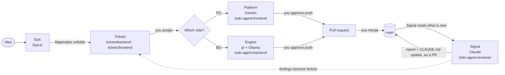

# Agent dev pipeline

How work moves from an idea to reviewed code in this repository, who does each part, and where the human decides. Written for the person in the middle: you should be able to read this page and know, at any moment, what each agent is doing, where, and what it is waiting for.

**Status of this document:** the left half of the pipeline (epics, tickets, the two builder workspaces) is how we already work. The reviewer workspace, the review cursor and the agent names are **proposed** here and marked so. Nothing in this file is enforced by tooling yet.

## 1. The line at a glance

The app draws bills as lines on a network map, so the pipeline borrows the same picture: work travels along one line, and it stops at every station where the human must wave it through.



## 2. The crew

| Name | Role | Harness / model | Works in | May change | Never changes |
|---|---|---|---|---|---|
| **Dispatcher** | You. Assigns tickets, approves every commit, push, PR and merge, sets priority | — | anywhere | everything | — |
| **Mapmaker** | Planner. Writes epics and unfolds them into tickets | Claude Code | `todo-agent` (main workspace) | `Epics/`, `tickets/`, docs | application code |
| **Platform** | Frontend builder. What the passenger sees | Gemini CLI | `todo-agent-frontend` | `web/`, its own `FE-` ticket | `api/`, `BE-` tickets |
| **Engine** | Backend builder. What moves the train | pi coding agent + Ollama (`kimi-k3:cloud` so far) | `todo-agent-backend` | `api/`, `Makefile`, Docker, its own `BE-` ticket | `web/`, `FE-` tickets |
| **Signal** *(proposed)* | Reviewer. Reads what was merged, reports, keeps `CLAUDE.md` true | Claude Code | `todo-agent-reviewer` (new clone) | `reviews/`, `CLAUDE.md`, ticket `Status` | application code |

Why three builders' worth of separation: each clone has its own working tree and branch, so two agents never edit the same files at the same time, and each diff you review comes from one agent doing one ticket.

All workspaces are clones of the same GitHub repository (`origin`). Work meets only on `main`, through pull requests.

### Can the agents really carry these names?

Checked on this machine on 2026-11-16:

| Where the name can live | Platform (Gemini) | Engine (pi) | Signal (Claude) |
|---|---|---|---|
| Session display name | No flag for it (`gemini --help` offers only session IDs) | Yes: `pi --name Engine` | Yes: the session title |
| Told its name and role in its instructions | A context file in the workspace (see 7) | `--append-system-prompt`, or the workspace instructions file | `CLAUDE.md` in its workspace |
| Ticket header | `Assigned agent / harness / model:` already exists in every ticket | same | same |
| Commit trailer | `Agent: Platform (gemini / <model>)` | `Agent: Engine (pi / ollama / kimi-k3:cloud)` | `Agent: Signal (claude / <model>)` |

So: yes. The names that matter to you are the ones in **the ticket header and the commit trailer**, because those survive in the repository and work the same for every harness. Session names are a convenience on top.

Proposed convention:

- Ticket header: `- **Assigned agent / harness / model:** Engine / pi + ollama / kimi-k3:cloud`
- Last line of every agent commit: `Agent: <Name> (<harness> / <model>)`
- Branch names stay as they are (`idelamadrid/BE-061-…`); the ticket ID already tells you whose it is (`BE-` is Engine, `FE-` is Platform, `review-` is Signal).

`git log --grep "Agent: Engine"` then lists everything one agent wrote, which is useful when a model changes and you want to compare.

## 3. A map of the codebase

Read this once; it is the mental model every ticket assumes.

```
todo-agent/
├── CLAUDE.md            The rules and the domain model. Signal keeps it current.
├── DESIGN.md            Look and feel: tokens, type scale, components. Platform's bible.
├── PRODUCT.md           What the product is for.
├── Epics/               Feature-level requirements. Mapmaker writes, you polish.
├── tickets/
│   ├── backend/  BE-…   One small, reviewable job each. Engine's queue.
│   └── frontend/ FE-…   Platform's queue.
├── api/                 ── ENGINE'S TERRITORY ──────────────────────────────
│   ├── app/main.py          App factory: builds FastAPI, mounts routers, each behind auth.
│   ├── app/security.py      The shared auth dependency. The only place credentials are read.
│   ├── app/settings.py      Environment → one frozen Settings object. Fails at start-up if wrong.
│   ├── app/db.py            Database engine and sessions.
│   ├── app/routes/          Small routers (public health checks, …).
│   ├── app/bills/           The reference feature. New features copy its shape:
│   │   ├── schemas.py         what JSON looks like (camelCase on the wire)
│   │   ├── domain.py          the rules, as pure functions (is this bill due?)
│   │   ├── models.py          database tables
│   │   ├── repository.py      the only code that talks to the database
│   │   └── router.py          HTTP endpoints: validate → call domain/repository → respond
│   └── tests/               pytest, run in parallel.
├── web/                 ── PLATFORM'S TERRITORY ────────────────────────────
│   ├── vite.config.ts       Dev server and the /api proxy.
│   ├── src/App.tsx          The shell plus the current screen.
│   ├── src/components/      AppShell and shadcn/ui primitives.
│   └── src/features/bills/  The reference feature on this side:
│       ├── model/             types and pure logic (schedule.ts mirrors domain.py)
│       ├── api/client.ts      typed calls to the backend
│       ├── store/             Zustand: state and transitions
│       └── components/        what you see, one file per piece
├── Makefile             Every command you need: `make help`.
├── docker-compose.yml   Postgres and Redis for local work.
└── RUNBOOK-*.md         Step-by-step for humans (migrations, Telegram, Clerk).
```

### Follow one click

The fastest way to understand the layers is to trace "mark a bill as paid":

| Step | File | What happens |
|---|---|---|
| 1 | `web/src/features/bills/components/MarkPaidPopover.tsx` | You type the amount and confirm |
| 2 | `web/src/features/bills/store/useBillsStore.ts` | The store updates the screen at once (optimistic) and calls the client |
| 3 | `web/src/features/bills/api/client.ts` | `PUT /api/bills/{id}/payments/{period}` with `actualCents` |
| 4 | `web/vite.config.ts` | The dev proxy forwards `/api/*` to the API |
| 5 | `api/app/main.py` → `api/app/security.py` | The request must pass the shared auth dependency, or it stops with `401` |
| 6 | `api/app/bills/router.py` | Validates the body with `schemas.py` |
| 7 | `api/app/bills/domain.py` | Pure rule: is this bill due in that month? |
| 8 | `api/app/bills/repository.py` → `models.py` | Upserts the payment row in Postgres |
| 9 | back up the same path | JSON response; the store keeps or rolls back the optimistic change |

Two ideas explain most of the code: **rules are pure functions in the middle** (`domain.py`, `schedule.ts`), and **side effects sit at the edges** (router, repository, client, store). Both builders are told to keep it that way, and Signal checks it.

## 4. The pipeline, station by station

Stations marked ✋ wait for you. An agent that reaches one stops and asks.

| # | Station | Who | What happens | Leaves behind |
|---|---|---|---|---|
| 1 | Epic | Mapmaker + you | An idea becomes an epic with open questions; you answer them | `Epics/EPIC-0NN-….md` |
| 2 | Unfold | Mapmaker | `/unfold-epic` slices it into tickets small enough to review in 15 minutes | `tickets/backend/BE-…`, `tickets/frontend/FE-…` |
| 3 | ✋ Assign | You | Pick the next ticket (dependencies met, highest priority), write the agent in its header | ticket header filled |
| 4 | Build | Platform or Engine | Reads the ticket only, branches, sets `Status: in-progress`, writes code and tests, runs the suite | a branch in its clone |
| 5 | ✋ Commit | You | The agent shows the diff and asks; you read it against the ticket's **Review guide** | a commit with the `Agent:` trailer |
| 6 | ✋ Push and PR | You | The agent asks again; it sets `Status: review` | a pull request |
| 7 | ✋ Merge | You | Optional: comment `@claude review` on the PR for a second opinion before merging | a merge commit on `main` |
| 8 | Sweep | Signal | Reviews everything merged since its cursor (see 5) | a report, a `CLAUDE.md` diff, tickets set to `done` |
| 9 | ✋ Accept the sweep | You | Merge Signal's PR; turn findings you agree with into tickets | cursor moved |

Rules that keep the line safe:

- **One ticket, one branch, one agent, one PR.** If a diff grows past the ticket's review size, the agent stops and says so.
- **Builders read only their ticket and the files it names.** Everything they need is in the ticket; that is what the unfold step is for.
- **Nobody commits, pushes, opens a PR or merges without your explicit yes.** Each yes covers one action.
- **Agents never read out, print or log secrets** (API keys, bot tokens, Clerk keys). Humans fill the `.env` files.
- **A builder that needs something from the other side stops** and writes it in the ticket's Notes. It does not cross into the other folder.

## 5. Signal and the cursor (proposed)

Signal reviews **after** the merge, in its own clone, so it never slows a builder down and never has unreviewed code of its own in the way.

**The cursor** is one file, `reviews/CURSOR`, holding the last commit on `main` that Signal has reviewed:

```
6b18b19  2026-11-16  merged PR #13 (BE-060)
```

A sweep, step by step:

1. `git fetch`, then list what is new: `git log --first-parent --merges <cursor>..origin/main`.
2. For each merged PR: open its ticket, read the diff, and check it against
   - the ticket's acceptance criteria and review guide;
   - `CLAUDE.md`: every endpoint behind the shared auth dependency, integer cents, camelCase JSON, pure functions in the core, no hardcoded secrets;
   - for frontend: `DESIGN.md` tokens and the states the ticket named.
3. Run `make api-test`, `make web-test` and `make web-build` on the new `main`.
4. Write `reviews/YYYY-MM-DD-<short-sha>.md`: one section per PR with a verdict (**clear**, **note**, or **stop**), the evidence, and a suggested follow-up ticket for anything that is not clear.
5. Update `CLAUDE.md` where the merged code made it out of date: the domain model tables, the API list, a new shared convention. Each change cites the PR that caused it. Signal records what the code *is*; it does not invent new rules. A rule change is your decision.
6. Set the reviewed tickets to `Status: done` (or leave `review` and say why).
7. Move the cursor to the newest reviewed commit.
8. ✋ Ask to commit and open one PR (`review-<short-sha>`) with the report, the `CLAUDE.md` diff, the ticket statuses and the cursor.

Because the cursor only moves inside a PR you merge, a sweep you reject is simply repeated next time. Nothing is lost and nothing is reviewed twice.

What Signal never does: edit `api/` or `web/`, fix what it finds, or change priorities. Findings go back to the start of the line as tickets, through Mapmaker and you.

## 6. Your day as Dispatcher

```
Morning     Open tickets/. Pick one BE- and one FE- ticket whose dependencies are done.
            Start Engine and Platform, each in its own clone, each with one ticket.
During      Answer questions. When an agent says "ready to commit", read the diff
            with the ticket's Review guide next to it. Yes or no.
After merge Pull main in the main workspace so tickets and docs stay current.
End of day  Start Signal: "sweep". Read the report, merge its PR, decide on findings.
```

Kick-off lines you can paste (after setting up section 7):

| Agent | In | Say |
|---|---|---|
| Engine | `todo-agent-backend`, on an up-to-date `main` | `pi --name Engine`, then: "Work on tickets/backend/BE-061. Follow CLAUDE.md and the ticket. Stop and ask before committing." |
| Platform | `todo-agent-frontend`, on an up-to-date `main` | `gemini`, then: "Work on tickets/frontend/FE-009. Follow CLAUDE.md, DESIGN.md and the ticket. Stop and ask before committing." |
| Signal | `todo-agent-reviewer`, on an up-to-date `main` | `claude`, then: "Sweep: review everything merged since reviews/CURSOR, as AGENT-DEV-PIPELINE.md section 5 describes." |

When two tickets depend on each other across sides (for example FE-013 needs BE-063), the `Depends on` line tells you the order: merge the backend one first, then let Platform pull `main`.

## 7. Setting it up (one time, human steps)

Not done yet. Each is small and yours to run or approve.

1. **Reviewer clone:** clone the repository to `/Users/ignacio/todo-agent-reviewer`.
2. **Cursor:** create `reviews/CURSOR` on `main` with the commit you consider already reviewed. Starting from today's `main` is fine.
3. **Names in instructions:** give each workspace a few lines that tell the agent its name, its territory and the stop-and-ask rule. Each harness looks for its own file name, so confirm which one yours reads before relying on it:
   - Engine (pi): a workspace instructions file, or `--append-system-prompt` in a shell alias.
   - Platform (Gemini): a context file in the workspace root.
   - Signal (Claude): a short role section in that clone's `CLAUDE.md`, pointing at section 5 of this file.
   Keep these files to a pointer plus the role. The rules themselves stay in the root `CLAUDE.md`, so there is one source of truth.
4. **Ticket READMEs:** `tickets/backend/README.md` and `tickets/frontend/README.md` still say `origin` points to the main workspace folder. It points to GitHub. Worth correcting when this pipeline is adopted.
5. **Ticket status rule:** `tickets/README.md` says an agent updates tickets only in its own folder. Signal setting `done` on both sides is an exception to add there.

## 8. When something goes wrong

| Situation | What to do |
|---|---|
| A builder's tests fail and it cannot fix them within the ticket | It sets `Status: blocked` with the reason in Notes and stops. You decide: split the ticket, or hand it to another model |
| Two PRs conflict | Merge one; the other agent pulls `main` and resolves in its own clone. Never resolve by editing the other side's files |
| Signal marks a merge **stop** | Nothing is reverted automatically. Read the evidence, then either revert the PR yourself or open a fix ticket at priority 5 |
| `CLAUDE.md` and the code disagree | The code that passed your review is the fact; Signal proposes the `CLAUDE.md` change. If the *code* is what is wrong, that is a ticket |
| A local model produces weak work on a ticket | Reassign the ticket in its header to another agent or model. The `Agent:` trailers let you compare results later |
| An agent asks to do something outside its territory | The answer is no. The need becomes a ticket for the other side |
